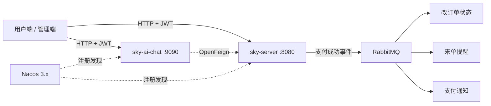
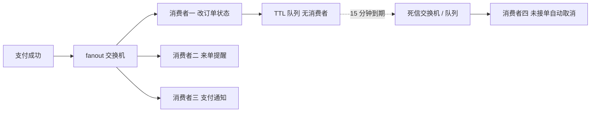
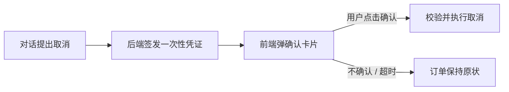

# 外卖微服务系统 · AI 智能客服

在外卖点单业务底座之上完成的**微服务化改造**与 **AI 智能客服**集成：服务间调用由硬编码 HTTP 改为 Nacos 注册发现 + OpenFeign，支付链路用 RabbitMQ 做异步解耦，超时未接单由 TTL + 死信队列自动关单，AI 侧通过自然语言驱动真实业务写操作（取消订单、再来一单、催单、清空购物车）。

仓库：<https://github.com/laitaobai/meituan-take-ai>

---

## 一、这个项目做了什么

| 方向 | 改造内容 |
| :--- | :--- |
| 服务治理 | AI 服务对交易服务的 4 处硬编码 `http://localhost:8080` 调用，改为 Nacos 注册发现 + OpenFeign 声明式调用 |
| 身份传递 | 移除「Redis 存全局 token」方案，改为请求级 JWT 透传，多用户严格隔离 |
| 消息异步化 | 支付成功后广播事件，三个消费者并行处理（改状态 / 来单提醒 / 支付通知） |
| 超时关单 | 队列级 TTL（15 分钟）+ 死信交换机，商家未接单自动取消，**不依赖延迟消息插件** |
| 写操作安全 | 取消订单需用户本人凭一次性凭证确认后执行，AI 无法直接改单 |
| AI 能力 | Spring AI `@Tool` 注册业务工具，RAG 检索菜品知识，SSE 流式输出 |

---

## 二、技术栈

**交易服务 `sky-server`（端口 8080）**

- Spring Boot 2.7.3 · MyBatis · PageHelper · Knife4j
- Spring Cloud 2021.0.5 · Spring Cloud Alibaba 2021.0.5.0（Nacos Discovery）
- Spring AMQP（RabbitMQ）· Redis · MySQL 8.0 · WebSocket · JWT · 阿里云 OSS

**AI 客服服务 `sky-ai-chat`（端口 9090，独立工程）**

- Spring Boot 4.1.1 · Spring AI 2.0.1 · Spring Cloud 2025.1.3 · Spring Cloud Alibaba 2025.1.0.0
- OpenFeign · SimpleVectorStore（RAG）· MessageWindowChatMemory · WebFlux SSE

> 两个服务的 Spring Boot 大版本不同（2.7 与 4.1），因此各自对接对应版本的 Spring Cloud Alibaba，注册到同一个 Nacos 3.x。Nacos 服务端同时兼容 2.x 与 3.x 客户端，这是避免全量升级的折中方案。

**基础设施（Docker Compose 一键启动）**

- Nacos 3.2.2 · RabbitMQ 3.13 · Redis 7 · MySQL 8.0

---

## 三、系统架构



- `sky-server` 提供全部业务接口（菜品、套餐、购物车、订单、营业额统计等）。
- `sky-ai-chat` 独立部署，通过 OpenFeign 调用交易服务，本身不直连数据库。
- 两侧都注册到 Nacos，调用方按服务名寻址，无硬编码地址。

---

## 四、支付成功后的消息链路

支付接口只做校验与投递即返回，**不阻塞在数据库写入和推送上**：



关键设计：

- **事务一致性**：用 `TransactionSynchronizationManager.afterCommit` 保证支付事务提交后才发消息，避免事务回滚但消息已投递。
- **消费幂等**：Redis SETNX 按「消费者 + 订单号」标记，重复投递不会重复处理；手动 ACK，失败重投。
- **超时关单不装插件**：TTL 队列不注册任何消费者，消息到期后由 RabbitMQ 自动投递到死信交换机。消费者按订单当前状态判断，已接单或已取消的订单直接忽略，并置支付状态为退款。

---

## 五、取消订单为什么需要用户确认

用户在对话里随口一句「帮我取消订单」不应直接改库。因此 AI 侧只能**提交申请**，真正执行必须由用户本人完成：



- 凭证存 Redis，**5 分钟有效期，用后即删**。
- 校验订单归属与状态机：不是本人的订单、已完成 / 已取消的订单一律拒绝。
- AI 服务的 Feign 客户端**不声明直接取消的方法**，从编译期杜绝绕过。
- 用户在订单页手动取消仍然即时生效，只有 AI 路径强制二次确认。

---

## 六、目录结构

```
.
├── sky-common        # 公共模块：常量、异常、工具类、JWT、OSS、结果封装
├── sky-pojo          # 实体、DTO、VO
├── sky-server        # 交易服务（端口 8080）
│   └── com.sky
│       ├── controller    # admin / user / notify 三类接口
│       ├── service       # 订单、菜品、套餐、购物车等业务
│       ├── mapper        # MyBatis 接口与 XML
│       ├── mq            # RabbitMQ 配置、生产者、四个消费者
│       ├── config        # Redis / WebSocket / WebMvc
│       ├── interceptor   # JWT 拦截器
│       └── websocket     # 来单提醒与定向推送
├── sky-ai-chat       # AI 客服服务（端口 9090，独立工程，不在父 POM 的 modules 中）
│   └── com.sky.taobai
│       ├── controller    # /chat（SSE）、/pending-action
│       ├── Service       # @Tool 工具定义与业务调用
│       ├── client        # OpenFeign 客户端
│       └── context       # 待确认动作存储
├── docker-compose-infra.yml   # MySQL / Redis / Nacos / RabbitMQ
└── pom.xml
```

---

## 七、快速开始

### 1. 启动基础设施

```bash
docker compose -f docker-compose-infra.yml up -d
```

| 服务 | 地址 | 说明 |
| :--- | :--- | :--- |
| Nacos | <http://localhost:8080> | 3.x 起控制台独立端口，且不再带 `/nacos` 前缀 |
| RabbitMQ | <http://localhost:15672> | 账号 `sky` / `sky123456` |
| MySQL | localhost:3306 | 库 `sky_take_out`，root / 123456 |
| Redis | localhost:6379 | 无密码，db 10 |

### 2. 初始化数据库

创建 `sky_take_out` 库并导入建表脚本。仓库**未附带 SQL 脚本**，可把脚本放到仓库根目录的 `sql/` 下，Compose 会在 MySQL 首次启动时自动导入。

### 3. 配置交易服务

编辑 `sky-server/src/main/resources/application-dev.yml`：数据源、Redis、阿里云 OSS、微信支付（可选）。密钥建议走环境变量，不要硬编码。

### 4. 配置 AI 服务

```bash
set DASHSCOPE_API_KEY=你的大模型密钥
```

`sky-ai-chat/src/main/resources/application.yaml` 中模型走 OpenAI 兼容接口，默认是通义千问 `qwen3.8-max` 与 `text-embedding-v4`，可自行替换 `base-url` 与模型名。

### 5. 启动

```bash
mvn -B -DskipTests compile        # 父工程（sky-common / sky-pojo / sky-server）
cd sky-ai-chat && mvn -B -DskipTests compile   # AI 服务单独构建
```

分别运行 `SkyApplication`（8080）与 `SkyAiChatApplication`（9090）。

### 6. 验证 AI 对话

```bash
curl -N --header "authentication: {用户登录后拿到的 JWT}" ^
     "http://localhost:9090/chat?msg=帮我取消订单 123"
```

**前端接入要点**：

1. 调 `/chat` 时带上 `authentication` 请求头（JWT），否则 AI 侧无身份，业务调用会返回 401。
2. 对话结束后拉 `GET /pending-action`，若返回内容则弹确认卡片。
3. 用户确认后调 `POST /user/order/cancel/confirm`（body 为 `{ "token": "..." }`），随后 `DELETE /pending-action` 清除。
4. WebSocket 需以 **userId 作为 sid** 连接（`ws://host/ws/{userId}`），否则收不到定向的支付成功通知。

---

## 八、主要接口

| 分类 | 方法 | 路径 | 说明 |
| :--- | :--- | :--- | :--- |
| 用户 | POST | `/user/user/login` | 微信登录，返回 JWT |
| 用户 | POST | `/user/order/submit` | 提交订单 |
| 用户 | PUT | `/user/order/payment` | 订单支付 |
| 用户 | POST | `/user/order/updateStatus` | 跳过支付，直接置为已支付 |
| 用户 | PUT | `/user/order/cancel/{id}` | 用户手动取消（即时生效） |
| 用户 | PUT | `/user/order/cancel/apply/{id}` | 提交取消申请，返回一次性凭证 |
| 用户 | POST | `/user/order/cancel/confirm` | 用户确认后执行取消 |
| 用户 | POST | `/user/order/repetition/{id}` | 再来一单 |
| 用户 | GET | `/user/order/reminder/{id}` | 催单 |
| 管理端 | PUT | `/admin/order/confirm` | 接单 |
| 管理端 | PUT | `/admin/order/rejection` | 拒单 |
| 管理端 | PUT | `/admin/order/delivery/{id}` | 派送 |
| 管理端 | PUT | `/admin/order/complete/{id}` | 完成 |
| AI | GET | `/chat?msg=` | SSE 流式对话 |
| AI | GET / DELETE | `/pending-action` | 查询 / 清除待确认动作 |

接口文档：`http://localhost:8080/doc.html`（Knife4j）。

---

## 九、测试

```bash
mvn -pl sky-server -am test -Dtest='OrderServiceImplTest,OrderMessageConsumerTest'
cd sky-ai-chat && mvn test -Dtest='JwtTest,PendingActionStoreTest,UserAiServiceImplTest'
```

> 注意：`-am` 不能省略。单独构建 `sky-server` 会引用本地仓库里过旧的 `sky-pojo` 包而编译失败。

29 个用例覆盖：取消申请不改订单、凭证一次性、越权与状态校验、消费幂等、四个消费者分发、超时取消只处理待接单订单等。

---

## 十、已知限制

- AI 服务的接口（含 `/chat`）目前**没有鉴权**，仅靠下游交易服务的 JWT 校验兜底，生产环境需要补。
- `PendingActionStore` 是单实例内存实现，AI 服务多实例部署时需换成 Redis。
- 支付接口为纯异步，若 MQ 与消费者同时不可用，订单会停留在待付款状态；需要同步兜底可再加降级分支。
- TTL 时长（15 分钟）是编译期常量 `RabbitMQConfig.ACCEPT_TIMEOUT_MILLIS`，调整后需删除队列才会重新声明生效。
- 微信支付相关代码保留但未启用，实际走「跳过支付」路径。

---

## 十一、开源协议

MIT License。业务底座参考自苍穹外卖开源教学项目，AI 与微服务改造部分为个人实现。
